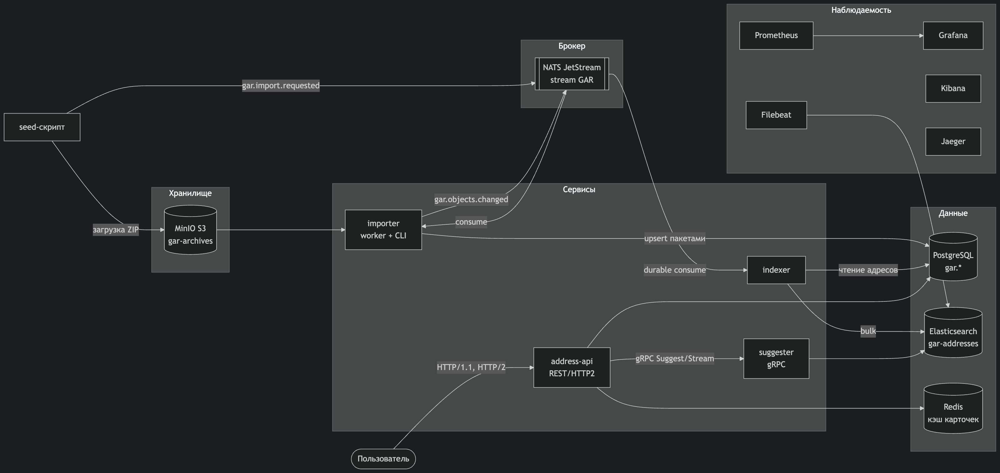
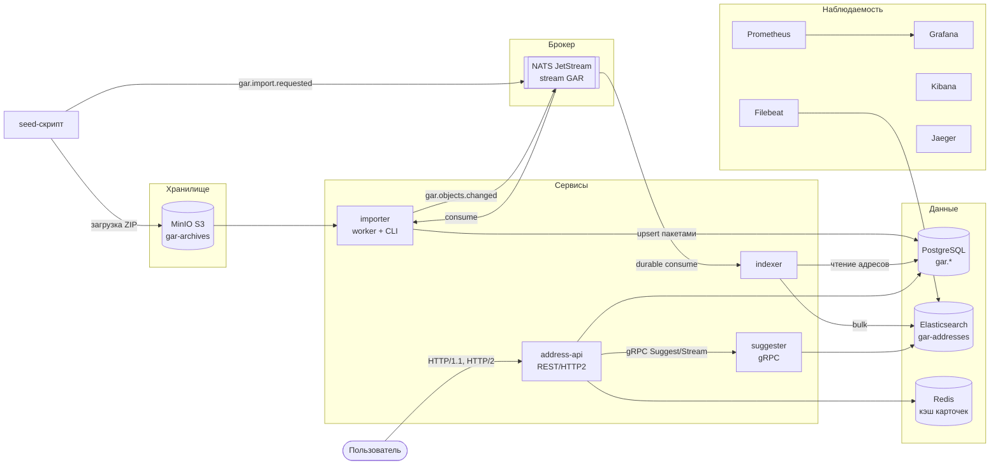

# Архитектура платформы адресного поиска ГАР

Отчёт по архитектуре решения. Потоки данных, границы сервисов, контракты,
принятые решения и их обоснование. Скриншоты работающей системы — в `demo.md`.

## Обзор

Платформа превращает файловую выгрузку ГАР (ФИАС) в работающий адресный поиск:

1. ZIP-архив выгрузки кладётся в распределённое хранилище (MinIO, S3 API).
2. Задача импорта публикуется в брокер сообщений (NATS JetStream).
3. `importer` скачивает архив, потоково разбирает XML, валидирует по XSD-спецификациям
   и пакетно записывает в PostgreSQL (upsert, идемпотентно); по завершении каждого
   файла публикует событие `gar.objects.changed`.
4. `indexer` потребляет события, собирает из нормализованных таблиц плоские
   поисковые документы (полный адрес по `PATH` иерархии) и пакетно пишет
   в Elasticsearch.
5. Пользователи работают через `address-api` (REST, HTTP/2): подсказки — через
   gRPC-сервис `suggester` поверх Elasticsearch, карточки адресов — из PostgreSQL
   с кэшем в Redis.





## Сервисы и границы ответственности

| Сервис | Ответственность | Хранилища | Контракты |
|---|---|---|---|
| `importer` | Миграции схемы `gar`; импорт ZIP из S3 → PostgreSQL; публикация событий | PostgreSQL (запись) | consume `gar.import.requested`, produce `gar.objects.changed` |
| `indexer` | Сборка поисковых документов, bulk-индексация | PostgreSQL (чтение), Elasticsearch (запись) | consume `gar.objects.changed` |
| `suggester` | Поисковые подсказки | Elasticsearch (чтение) | gRPC `suggest.v1.Suggester` |
| `address-api` | Публичный API, кэширование, веб-клиент | PostgreSQL, Redis (чтение) | REST `api/openapi/address-api.yaml`, клиент gRPC |

Правило: каждое хранилище имеет ровно одного писателя. PostgreSQL пишет только
`importer`, Elasticsearch — только `indexer`. Читателей может быть сколько угодно.

## Контракты

### События (NATS JetStream, stream `GAR`, subjects `gar.>`)

`gar.import.requested` — задача импорта:

```json
{
  "schema_version": 1,
  "request_id": "40cf4654ff013709000b38e2122a1fa4",
  "bucket": "gar-archives",
  "key": "tiny-gar.zip",
  "regions": [77],
  "limit_per_file": 0,
  "batch_size": 1000,
  "requested_at": "2026-10-19T17:34:15Z"
}
```

`gar.objects.changed` — файл импортирован (публикуется после коммита пакета файла,
до фиксации файла в журнале: потеря события невозможна — при сбое публикации файл
будет переобработан и событие переиздано):

```json
{
  "schema_version": 1,
  "run_id": 2,
  "kind": "AS_HOUSES",
  "region": 77,
  "path": "77/AS_HOUSES_20251019_1.XML",
  "written": 5,
  "completed_at": "2026-10-19T17:34:16Z"
}
```

Семантика доставки: durable pull-потребители (`importer`, `indexer`), явные
ack/nak/term, `MaxDeliver 10` с backoff — at-least-once. Идемпотентность
обеспечивают upsert в PostgreSQL и upsert по `object_id` в Elasticsearch.
Дедупликация публикаций — `Nats-Msg-Id`.

### Поисковый документ (индекс `gar-addresses`)

```json
{
  "object_id": "201", "object_guid": "uuid", "kind": "house",
  "full_address": "Респ Фиксионская, г Фиксион, ул Первая, д 7",
  "name": "7", "type_name": "д", "region": "1", "level": 10,
  "is_actual": true, "is_active": true, "indexed_at": "…"
}
```

`full_address` — text (анализатор `russian`) с подполем `prefix` (edge_ngram 2–15)
для подсказок «по мере ввода» и подполем `keyword`. Сборка строки — по правилам
«Формирование адресной строки» (docs ГАР): компоненты из `PATH` административной
иерархии + типы из справочников (`addr_obj_types`, `house_types`, …).

### gRPC (`proto/suggest/v1/suggest.proto`)

- `GetAddress(object_id)` — unary, карточка из индекса; `NOT_FOUND` при промахе.
- `Suggest(query, limit, region, actual_only)` — unary, список подсказок.
- `StreamSuggestions(...)` — server-streaming: сначала prefix-совпадения, затем
  fuzzy-добивка (без повторов), клиент получает первые результаты раньше.

### REST (`api/openapi/address-api.yaml`)

- `GET /api/v1/suggest?q&limit&region&actual_only` — прокси к gRPC `Suggest`.
- `GET /api/v1/addresses/{object_id}` — карточка из PostgreSQL, кэш Redis
  (`X-Cache: hit|miss`, TTL 5 мин).
- `GET /api/v1/addresses/{object_id}/children` — дети по административной иерархии.
- Служебные: `/healthz`, `/readyz`, `/metrics`, `/openapi.yaml`, `/swagger/`, `/`.
- Один порт 8080: HTTP/1.1 (браузеры) и HTTP/2 (prior knowledge, без TLS).

## Решения и обоснования

1. **Событийная цепочка вместо двойной записи.** Importer не знает о поисковом
   индексе: согласованность достигается событиями через JetStream (at-least-once +
   идемпотентные потребители). Брокер недоступен → импорт падает до фиксации
   файла в журнале и повторяется; indexer недоступен → события копятся в стриме
   и доезжают после его подъёма (проверено хаос-тестом, см. `fault-tolerance.md`).
2. **Переиндексация по (kind, region), а не по списку ID.** Событие несёт вид
   формата и регион; indexer перечитывает актуальный срез из PostgreSQL. Сообщения
   остаются компактными на файлах любого размера, повторная обработка безопасна.
   Цена — лишнее чтение при частых дельтах; принято как trade-off v1.
3. **Elasticsearch и для поиска, и для логов.** Один кластер закрывает NoSQL-поиск
   (`gar-addresses`) и требование «логи в Elastic» (`gar-logs-*` через Filebeat),
   без второго движка.
4. **Redis — только кэш карточек.** Подсказки идут в ES напрямую (это его
   профильная нагрузка), а карточки из PostgreSQL кэшируются: на горячих адресах
   hit ratio 99.9% (см. `load-testing.md`), при недоступности PostgreSQL карточки
   из кэша продолжают отдаваться (см. `fault-tolerance.md`).
5. **HTTP/2 без TLS (h2c→`http.Server.Protocols`).** Демо-контур за localhost;
   TLS-терминация — забота фронтового прокси в проде. Реализация на нативном
   `Protocols` (Go 1.24+), без устаревшего `x/net/h2c`.
6. **Один Go-модуль на репозиторий.** Общие пакеты (`internal/gar`, `internal/address`,
   `internal/platform`…) импортируются всеми сервисами без версионирования;
   границы сервисов — по процессам и данным, не по репозиториям.
7. **Версионированные миграции Atlas.** Схема `gar` применяется при старте
   `importer`'а и one-shot сервисом `migrate` (advisory lock, реестр ревизий) —
   решение самоинициализирует свои базы.
8. **Деградация по контуру чтения.** Отказ PostgreSQL не ломает подсказки (они идут
   в ES), отказ Redis не ломает карточки (fallback в БД), отказ ES не ломает
   карточки. Проверено хаос-тестами.

## Развёртывание

Один `compose.yaml`: 14 инфраструктурных сервисов + 4 Go-сервиса (сборка из
исходников, multi-stage Dockerfile на сервис в `services/*/Dockerfile`).
One-shot инициализаторы: `migrate` (схема БД), `minio-init` (бакет), `kibana-init`
(data view). Все порты опубликованы только на `127.0.0.1`.

Ограничения v1 (сознательные): один узел каждого хранилища (без реплик);
переиндексация по региону целиком; без аутентификации на API (демо-контур);
`full_address` без корпусов в отдельных полях документа.
