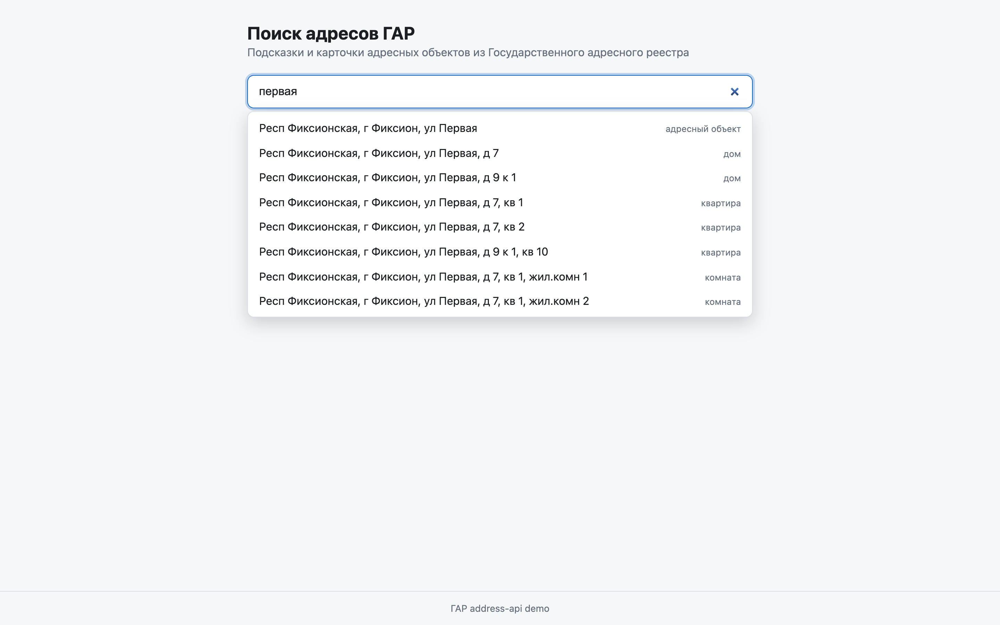
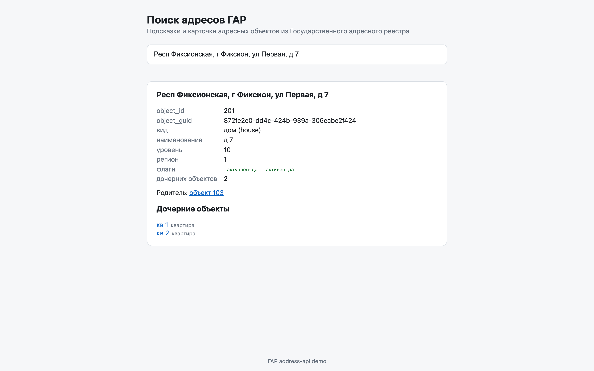
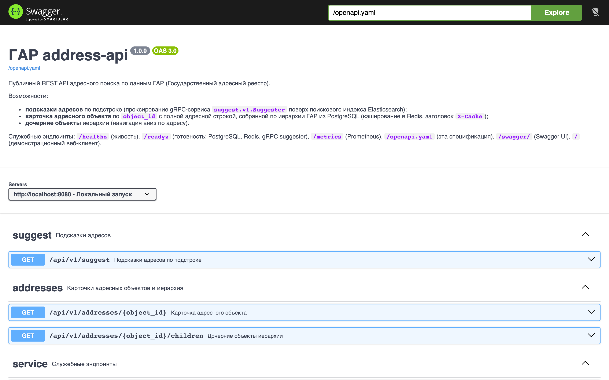
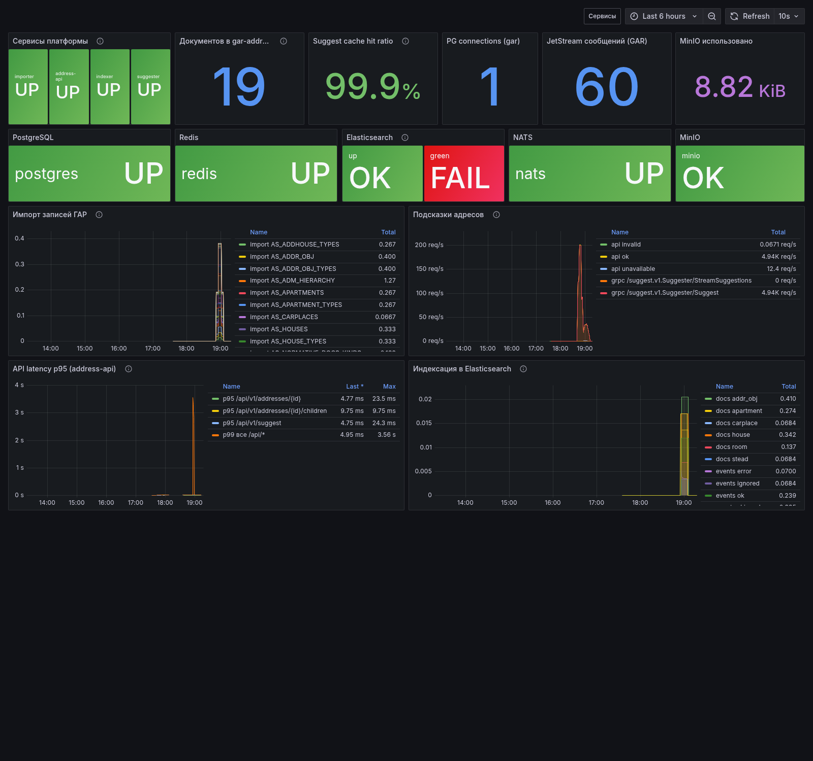
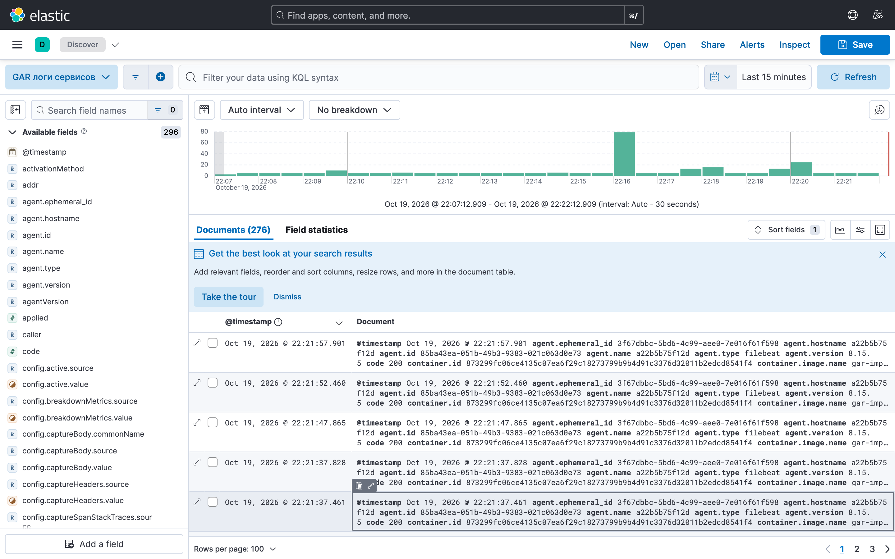
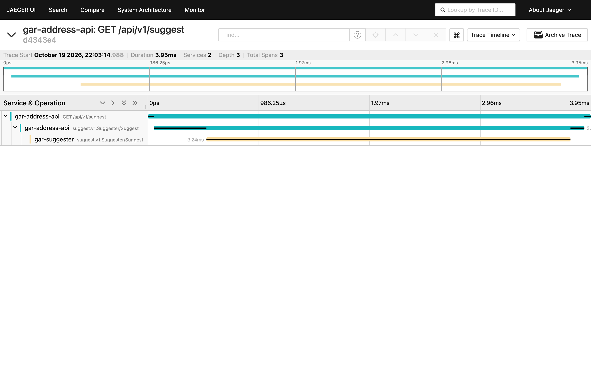

# Демонстрация платформы

Пошаговый прогон решения на локальном стеке. Команды — из корня репозитория.
Окружение: macOS (ARM), Docker Desktop, Go 1.27.1; данные — синтетическая
фикстура (`cmd/gar-mkfixture`, 19 XML-файлов, 111 записей, регион 01).

## 1. Запуск

```sh
cp .env.example .env
make up          # docker compose up -d --build --wait
```

Поднимаются 18 контейнеров: 4 Go-сервиса (importer, indexer, suggester,
address-api), PostgreSQL, Elasticsearch, Kibana, Filebeat, NATS JetStream,
MinIO, Redis, Prometheus, Grafana, Jaeger и экспортёры метрик.

One-shot инициализация проходит автоматически: `migrate` применяет
Atlas-миграции схемы `gar`; `minio-init` создаёт бакет `gar-archives`;
`kibana-init` создаёт data view `gar-logs-*`; `indexer` при старте создаёт
индекс `gar-addresses` с маппингом. Ручная инициализация не нужна.

## 2. Демо-данные (событийный конвейер)

```sh
make seed-fixture
```

Цепочка, видимая в логах (`docker compose logs -f importer indexer`):

1. `gar-mkfixture` генерирует валидный ZIP ГАР (`build/tiny-gar.zip`).
2. Скрипт загружает его в MinIO: `s3://gar-archives/tiny-gar.zip`.
3. В NATS публикуется `gar.import.requested` (печатается `RequestID`).
4. `importer` скачивает архив из MinIO, импортирует 111 записей в PostgreSQL
   (`задача импорта выполнена … run_id=2, files=19, written=111`), публикует
   `gar.objects.changed` по каждому файлу.
5. `indexer` получает события, собирает документы и пишет в Elasticsearch
   (`индекс пересобран … kind=AS_HOUSES region=1`).

Проверка: `curl -s localhost:9200/gar-addresses/_count` → 19 документов.

## 3. Веб-клиент

http://localhost:8080 — поле ввода с автодополнением (debounce →
`GET /api/v1/suggest`), карточка выбранного адреса со всеми полями,
бейдж «из кэша» при повторном открытии (заголовок `X-Cache: hit`),
кликабельные дети и родитель по иерархии.





## 4. REST API и Swagger

Спецификация `api/openapi/address-api.yaml` отдаётся на `/openapi.yaml`,
интерактивный Swagger UI — на `/swagger/` (завендорен в бинарь, работает офлайн).



Примеры:

```sh
curl --http2-prior-knowledge 'http://localhost:8080/api/v1/suggest?q=первая&limit=3' | jq
curl -s http://localhost:8080/api/v1/addresses/201 | jq
curl -s http://localhost:8080/api/v1/addresses/103/children | jq
```

HTTP/2 проверяется `curl --http2-prior-knowledge` (ответ `HTTP/2 200`),
браузеры используют HTTP/1.1 на том же порту.

## 5. gRPC: unary и стриминг

Reflection включён, демонстрация через grpcurl (на хосте или контейнером
`fullstorydev/grpcurl` в сети compose):

```sh
grpcurl -plaintext localhost:50051 list
# grpc.health.v1.Health, grpc.reflection..., suggest.v1.Suggester

grpcurl -plaintext -d '{"object_id":"201"}' \
  localhost:50051 suggest.v1.Suggester/GetAddress

grpcurl -plaintext -d '{"query":"фиксион","limit":3}' \
  localhost:50051 suggest.v1.Suggester/StreamSuggestions
```

`StreamSuggestions` отдаёт сначала prefix-совпадения, затем fuzzy-добивку —
клиент получает первые результаты до завершения поиска.

## 6. Метрики: Prometheus и Grafana

Prometheus (http://localhost:9090) собирает `/metrics` четырёх сервисов и
экспортёры postgres/redis/elasticsearch/nats/minio. Grafana
(http://localhost:3000) провизионирует три дашборда:

- **GAR Platform — Основной** (`/d/gar-main`): бизнес-метрики (rate импорта,
  документы в индексе, подсказки, cache hit ratio, p95 API) + ключевые
  инфраструктурные (статусы, соединения PG, сообщения JetStream, объём MinIO).
- **GAR Platform — Сервисы** (`/d/gar-services`): RPS/латентность/ошибки/ресурсы
  по каждому сервису (переменная `$service`).
- **GAR Platform — Инфраструктура** (`/d/gar-infra`): PostgreSQL, Redis,
  NATS JetStream, Elasticsearch, MinIO в деталях.



## 7. Логи: Filebeat → Elasticsearch → Kibana

Все сервисы пишут структурированные JSON-логи (slog) в stdout; Filebeat
(docker autodiscover) декодирует JSON и отправляет в датастрим `gar-logs-*`.
Kibana (http://localhost:5601 → Discover, data view «GAR логи сервисов»):
фильтр `service.name: "gar-address-api"`, поля `msg`, `level`, `trace_id`.



## 8. Трейсы: Jaeger

Все сервисы шлют OpenTelemetry-спаны в Jaeger (OTLP). Сквозной трейс
`GET /api/v1/suggest`: `address-api (http server)` → `address-api (grpc client)`
→ `suggester (grpc server)` — http://localhost:16686.



## 9. Проверка целиком

```sh
scripts/smoke.sh            # health всех сервисов, REST, HTTP/2, swagger, prometheus targets
scripts/smoke.sh --with-seed  # + полный конвейер на фикстуре
```

Нагрузка и отказоустойчивость: `load-testing.md`, `fault-tolerance.md`.
