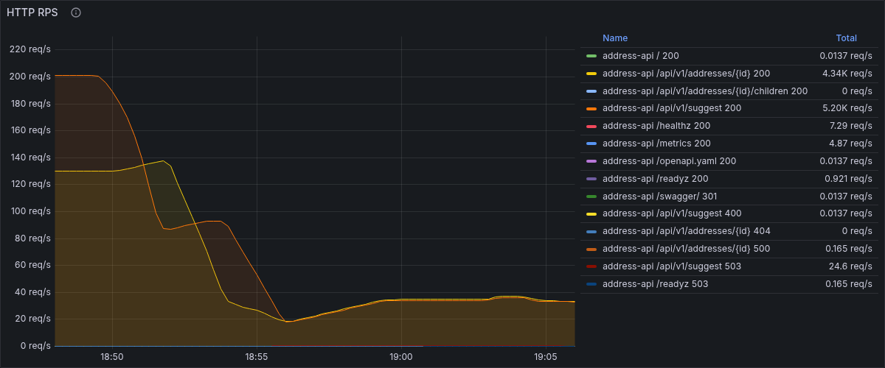
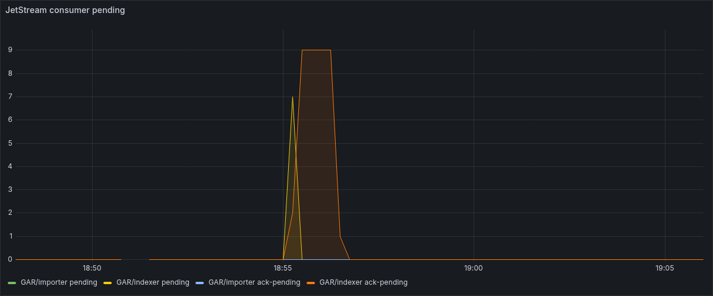
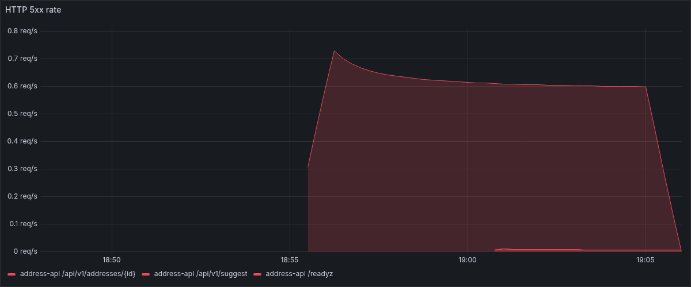
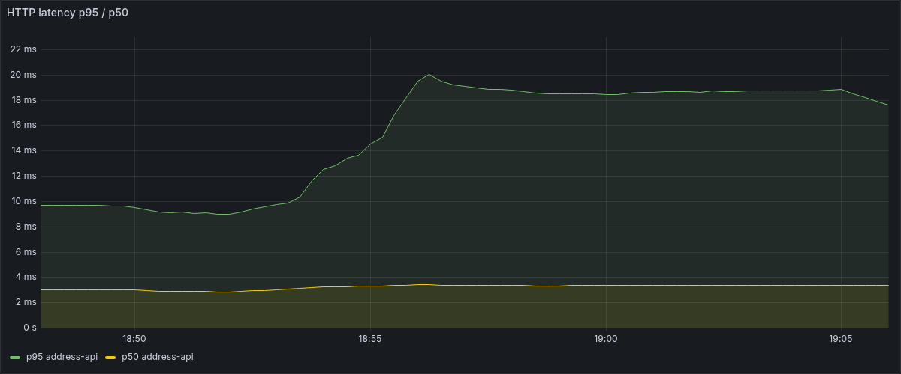

# Тест отказоустойчивости платформы ГАР (хаос-инженерия)

Дата прогона: 19.10.2026. Скрипты: [scripts/chaos/](../../scripts/chaos/),
логи прогонов: [scripts/chaos/results/](../../scripts/chaos/results/).
Каждый эксперимент выполнялся под фоновой нагрузкой k6 (сценарий
`tests/load/background.js`, 20 VU, 50% suggest / 50% details).

Окружение — как в [load-testing.md](load-testing.md): macOS/ARM64,
Docker Desktop, фикстура региона 01 (19 документов в `gar-addresses`).

## Матрица сценариев

| Отказ | Простой | Поведение системы во время отказа | Восстановление | Потеря данных |
|---|---|---|---|---|
| NATS (JetStream) | 30 с | REST API полностью работает: suggest=200, details=200, /readyz=200 (путь API не зависит от NATS); importer и indexer уходят в not-ready (readyz=503) и циклически переподключаются | healthy через 6 с после `start`; importer/indexer readyz=200 <1 с спустя; полный цикл 37 с | нет |
| Elasticsearch | 45 с | suggest → **503 UNAVAILABLE** (корректная деградация по контракту); details → 200 (PostgreSQL+Redis не зависят от ES); address-api /readyz=200 (gRPC-соединение с suggester живо); suggester/indexer readyz не отвечают в таймаут 5 с; indexer отвечает на события Nak → повторные доставки | ES healthy через 6 с после `start`; suggest снова 200 <1 с спустя; полный цикл 71 с (из них 45 с — запланированный простой) | нет (9 Nak-циклов, события доехали) |
| PostgreSQL | 30 с | /readyz → 503; details без кэша → **500 INTERNAL**; **details из кэша Redis → 200 (X-Cache: hit)**; suggest → 200 во всём окне (путь через ES — изоляция отказов); importer not-ready, indexer readyz=200 (его готовность — ES+NATS) | postgres healthy через 6 с после `start`; API /readyz 200 <1 с спустя; полный цикл 38 с | нет |

Ошибки на стороне пользователей API (Prometheus, окно отказа + 90 с):

| Отказ | 2xx | 5xx | Детализация 5xx |
|---|---|---|---|
| NATS | 7 646 | 0 | — |
| Elasticsearch | 1 051 | 408 | все — suggest 503 |
| PostgreSQL | 7 866 | 6 | 500 на details (пробы некэшированного id самим скриптом) |

## Детали экспериментов

### NATS: остановка брокера под нагрузкой

Хронология (лог `kill-nats-215039.log`):

- фоновая нагрузка 20 VU, до отказа API RPS ~77;
- `docker compose stop nats` (21:50:39), простой 30 с: все пробы
  API — suggest=200, details=200, /readyz=200; importer и indexer —
  readyz=503 (готовность включает проверку соединения с NATS);
- `docker compose start nats` (21:51:10): healthy через 6 с, importer
  и indexer вернули readyz=200 менее чем через 1 с (автоматический
  reconnect клиента nats.go с экспоненциальным backoff);
- фоновый k6 за весь прогон (3 мин, включая простой): 17 400 запросов,
  **0 ошибок**, 100% checks, p95 = 13,0 мс — отказ брокера пользователи
  API не заметили.

### JetStream durability: события не теряются при недоступном потребителе

Фаза B того же эксперимента:

1. `docker compose stop indexer`.
2. Повторный seed фикстуры (`scripts/seed-demo.sh build/tiny-gar.zip`):
   importer обработал архив и опубликовал события `gar.objects.changed`.
3. Пока indexer стоял, в его durable-консьюмере накопилось **19 событий**
   (NATS monitoring `/jsz`: `num_pending` 0 → 19).
4. `docker compose start indexer` → healthy через 6 с → все события
   доставлены (`num_pending` 19 → 0, `num_redelivered` 0 — хватило
   первой доставки); в логах indexer — «индекс пересобран» по всем
   7 видам объектов (run_id=3); счётчик нового процесса
   `indexer_documents_indexed_total` вырос до 38 (полная переиндексация
   фикстуры). В `gar-addresses` стабильно 19 документов — повторная
   индексация идемпотентна.

### Elasticsearch: деградация подсказок и redelivery indexer

Хронология (лог `kill-elasticsearch-215454.log`):

- `docker compose stop elasticsearch` (21:54:54); через 3 с — повторный
  seed фикстуры, чтобы события дошли до indexer, пока ES лежит;
- пробы во время простоя: suggest=503 (`{"error":{"code":"UNAVAILABLE"}}`),
  details/101=200, address-api /readyz=200;
- suggester и indexer перестают отвечать на /readyz в таймаут 5 с
  (проверка готовности ждёт пинг ES) — k8s-проба считала бы их
  not-ready, что корректно;
- indexer в это время получает события `gar.objects.changed`, запись
  в ES падает → `Nak` с задержкой 10 с: счётчик
  `indexer_events_total{result="error"}` вырос с 0 до 9;
- `docker compose start elasticsearch` (21:55:57): healthy через 6 с
  (данные на volume, кластер поднимается быстро); suggest снова 200
  менее чем через 1 с после healthy — без ручного вмешательства;
- после подъёма ES повторная доставка прошла успешно:
  `indexer_documents_indexed_total` 38 → 76 (+38 — очередная полная
  переиндексация фикстуры), документов в индексе по-прежнему 19;
- фоновый k6 (5 мин): 23 047 запросов, 408 ошибок (1,77%) — все это
  suggest 503 в окне простоя; **запросы details — без единой ошибки**.

Время восстановления suggest: 71 с от остановки ES (45 с запланированного
простоя + ~6 с старт контейнера + ~20 с реакция healthcheck/readyz),
от команды `start` — 8 с.

### PostgreSQL: изоляция отказов и живучесть кэша

Хронология (лог `kill-postgres-220021.log`):

- предварительный прогрев кэша карточек (18 id корпуса);
- `docker compose stop postgres` (22:00:21), простой 30 с:
  - address-api /readyz → 503 (пинг БД обязателен для готовности);
  - suggest → 200 во всех пробах — подсказки идут через Elasticsearch
    и от PostgreSQL не зависят;
  - details/101 → **200, X-Cache: hit** во всех пробах — данные в Redis
    переживают отказ БД;
  - details/999999 (гарантированно мимо кэша) → **500 INTERNAL**
    (ошибка БД на чтении; см. примечание ниже);
  - importer readyz=503; indexer readyz=200 (его готовность — ES и NATS);
- `docker compose start postgres` (22:00:52): healthy через 6 с,
  address-api /readyz 200 менее чем через 1 с после healthy
  (пул `database/sql` переподключается сам: сразу после подъёма видно
  1 соединение вместо 6, далее пул восстанавливается по мере нагрузки);
- фоновый k6 (3,5 мин, включая простой): 20 280 запросов, **0 ошибок**,
  p95 = 13,5 мс; кэш: 10 078 hit / 21 miss (misses — холодный старт
  до отказа). Под нагрузкой с прогретым кэшем отказ БД для читающего
  трафика незаметен.

> Примечание: в задании ожидался код 503 для details без кэша; фактически
> обработчик отвечает 500 INTERNAL (маппинг ошибки БД в
> `services/address-api/internal/app/handlers.go`, `writeDescribeError`).
> Зафиксировано как есть; при желании привести к 503 — отдельная задача.

## Выводы

1. **Изоляция отказов работает по контуру чтения:** подсказки зависят
   только от Elasticsearch, карточки — от PostgreSQL+Redis, событийный
   конвейер — от NATS. Отказ любого одного компонента деградирует
   лишь свой срез функциональности, а не весь API.
2. **Потерь данных нет ни в одном сценарии:** JetStream durable-консьюмеры
   держат события, пока потребитель недоступен; при временной ошибке
   записи в ES indexer делает Nak и получает событие повторно.
3. **Восстановление везде автоматическое и быстрое:** 6 с до healthy
   у всех трёх инфраструктурных сервисов (restart с сохранёнными
   данными), <1–8 с до возврата прикладной функциональности.
   Ручных действий не потребовалось.
4. **Кэш Redis — реальный буфер отказа БД:** при 30-секундном простое
   PostgreSQL пользовательский трафик карточек обслуживался без ошибок.
5. Наблюдение для бэклога: indexer /readyz не проверяет PostgreSQL
   (остаётся 200 при мёртвой БД) — готовность отражает только ES+NATS;
   для полноты картины стоит добавить пинг БД.

## Графики

-  — `chaos-nats.png`: RPS/error rate API в окно отказа NATS (плоская линия, ошибок нет)
-  — `chaos-jetstream.png`: `jetstream_consumer_num_pending{consumer_name="indexer"}` — рост до 19 и сброс в 0
-  — `chaos-es.png`: доля 5xx на `/api/v1/suggest` (провал доступности → восстановление)
-  — `chaos-pg.png`: details 200 (X-Cache hit) на фоне 503 /readyz
