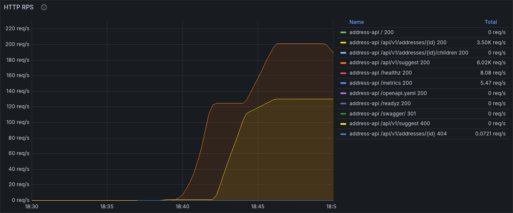
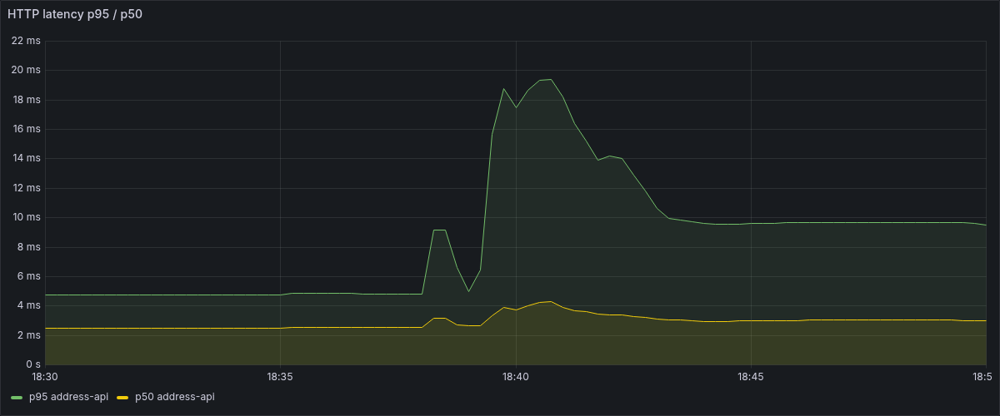
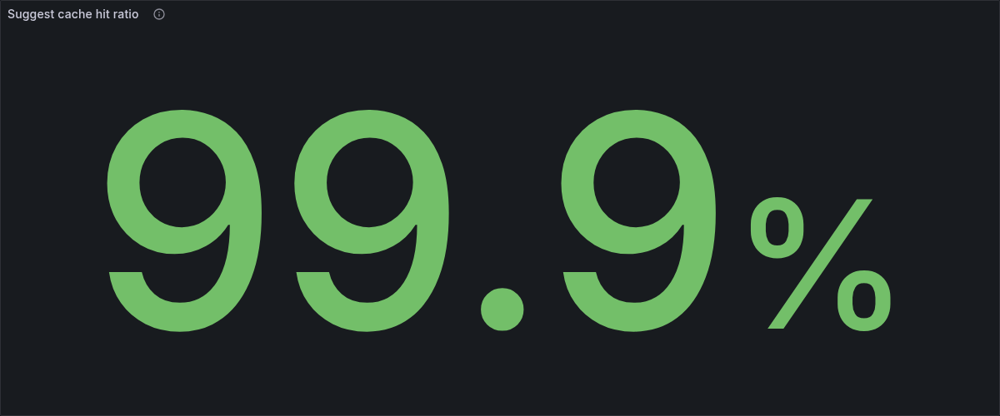
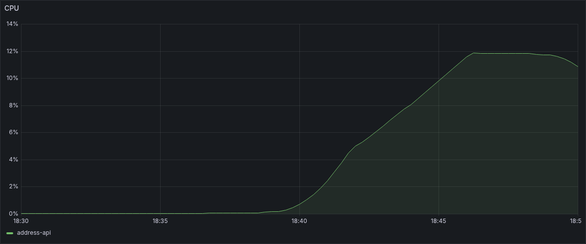

# Нагрузочное тестирование платформы ГАР

Дата прогона: 19.10.2026. Инструмент: k6 (`grafana/k6:0.54.0`, docker).
Сценарии: [tests/load/](../../tests/load/), сырые результаты: [tests/load/results/](../../tests/load/results/).

## Методика

### Окружение

| Параметр | Значение |
|---|---|
| Хост | macOS 27.0.1, Apple M3 Max (ARM64), 48 ГБ RAM |
| Docker | Engine 29.8.0, linux/aarch64, VM: 16 CPU / 24 ГБ |
| Стек | docker compose `gar-importer`, 18 контейнеров (см. README) |
| Данные | синтетическая фикстура региона 01: 19 документов в индексе `gar-addresses`, 18 адресных объектов в PostgreSQL |
| Цель нагрузки | `http://address-api:8080` (внутри compose-сети `gar-importer_default`) |
| Интервал сбора метрик Prometheus | 15 с |

k6 запускается контейнером в той же docker-сети, что и платформа, поэтому
сетевые задержки минимальны и измеряется в основном время обработки
приложением. Генератор нагрузки и цель делят один хост — при RPS в сотни
это не искажает картину (CPU API при пике — доли ядра, см. ниже).

### Корпус запросов

- suggest: `пер`, `фикс`, `первая`, `тест`, `моск` (последний заведомо даёт
  пустую выдачу — корректный ответ 200 с пустым `items`);
- details: все 18 существующих `object_id` фикстуры (101–106, 201–205,
  301–304, 306, 401, 501). id 305 в корпус не входит: такого объекта нет
  ни в PostgreSQL, ни в индексе, API корректно отвечает 404 NOT_FOUND.

### Сценарии

| Сценарий | Файл | Профиль | Длительность | Пороги |
|---|---|---|---|---|
| suggest | `suggest.js` | ramping 0→10 (30с) →50 (1м) →100 (1м) →0 (30с) | 3 мин | p95<500мс, errors<1% |
| details | `details.js` | постоянные 30 VU | 2 мин | p95<500мс, errors<1% |
| mixed | `mixed.js` | 50 VU, 80% suggest / 20% details | 2 мин | p95<500мс, errors<1% |

Каждая итерация — один HTTP-запрос со случайным параметром из корпуса
и паузой 0,05–0,1 с (имитация «думать-времени» пользователя). В details
дополнительно собирается кастомная метрика `cache_hit_ratio` по заголовку
`X-Cache` ответа.

## Результаты

### Сводная таблица (по данным k6)

| Метрика | suggest (ramp до 100 VU) | details (30 VU) | mixed (50 VU) |
|---|---|---|---|
| Запросов всего | 73 610 | 64 802 | 57 007 |
| Средний RPS | 408,9 | 539,8 | 474,7 |
| Пиковый RPS | ~848 (на 100 VU) | ~540 | ~475 |
| Latency avg | 5,97 мс | 2,71 мс | 4,03 мс |
| Latency p50 (med) | 3,17 мс | 1,74 мс | 3,00 мс |
| Latency p90 | 10,11 мс | 5,88 мс | 8,88 мс |
| Latency p95 | 12,49 мс | 7,14 мс | 11,42 мс |
| Latency max | 1599,5 мс¹ | 23,4 мс | 27,2 мс |
| Ошибки (http_req_failed) | 0 (0,00%) | 0 (0,00%) | 0 (0,00%) |
| Checks | 99,92% (220 663/220 830)² | 100% (194 406/194 406) | 100% (171 021/171 021) |
| Cache hit ratio | — | 99,94% (64 764 hit / 38 miss) | 100% по details-запросам |

¹ Единичный выброс на старте прогона (прогрев gRPC-соединения с suggester);
p95 при этом 12,5 мс.

² 167 провалов (0,23%) — чек «suggest: < 500ms» на отдельных запросах
в пике рампы до 100 VU (max 1,6 с). Порог checks>99% пройден, ошибок 5xx
при этом нет: речь о редких всплесках задержки под максимальной нагрузкой,
а не об отказах.

### Перцентили по данным самой платформы (Prometheus, `platform_http_request_duration_seconds`)

| Сценарий | p50 | p95 | p99 |
|---|---|---|---|
| suggest | 3,39 мс | 14,12 мс | 23,29 мс |
| details | 2,54 мс | 4,82 мс | 6,91 мс |
| mixed | 3,25 мс | 9,97 мс | 21,93 мс |

Разбивка p95 по эндпоинтам (сценарий mixed): suggest — 12,76 мс,
details — 4,78 мс. Подсказки закономерно дороже: путь идёт через gRPC
suggester → Elasticsearch, карточки в основном отдаются из Redis.

### Поведение на рампе (suggest, Prometheus, шаг 15 с)

| Время окна | RPS | p95, мс |
|---|---|---|
| 10–50 VU | 176 → 454 | 18,6 → 19,8 |
| рамп до 100 VU | 587 → 848 | 18,0 → 9,4 |

Задержка не растёт с ростом RPS — наоборот, слегка снижается за счёт
прогретых соединений и кэшей. Плато не достигнуто: узкое место не найдено
в пределах 100 VU / ~850 RPS.

### Инфраструктурные метрики во время mixed (50 VU, ~475 RPS)

Значения — усреднение 4–5 замеров Prometheus с интервалом 20 с
(файл `tests/load/results/infra-metrics-mixed.txt`).

| Метрика | Значение |
|---|---|
| RPS suggest / details (Prometheus) | ~378 / ~97 |
| Частота поисковых запросов к ES (`gar-addresses`) | ~379 qps |
| Операций Redis в секунду | ~97 (совпадает с RPS details) |
| CPU address-api | ~0,17 ядра |
| CPU suggester | ~0,30–0,41 ядра |
| RSS address-api / suggester / indexer / importer | ~50 / ~36 / ~44 / ~43 МБ |
| Подключения к PostgreSQL (`pg_stat_activity_count`, БД gar) | 9 |
| Ошибки 5xx на API | 0 |

## Выводы

1. **Запас по latency огромный.** Худший p95 (suggest на пике ~850 RPS) —
   около 14–20 мс при пороге 500 мс: запас в 25–35 раз. Все пороги
   (p95<500мс, errors<1%, checks>99%) пройдены с нулём ошибок
   на 195 419 запросах суммарно.
2. **Кэш Redis работает как задумано:** hit ratio 99,9%+ уже на двухминутном
   прогоне details; карточки обслуживаются за ~2–5 мс и почти не трогают
   PostgreSQL (всего 9 соединений, пул из 8 у address-api + фоновые).
3. **Узких мест на фикстурном объёме не видно:** суммарный CPU двух горячих
   сервисов (address-api + suggester) при ~475 RPS — около 0,5 ядра из 16.
   Предел пропускной способности в этой конфигурации не достигнут; он
   заметно выше 850 RPS и упирался бы, судя по росту CPU suggester,
   в первую очередь в suggester/Elasticsearch.
4. **Ограничение методики:** данные — крошечная синтетическая фикстура
   (19 документов), поэтому Elasticsearch отвечает из горячего page cache.
   На полной выгрузке ГАР (~80 млн объектов) абсолютные цифры latency будут
   выше; полученные значения — характеристика накладных расходов платформы,
   а не прогноз для продуктивного объёма.

## Графики

-  — `load-rps.png`: RPS API по сценариям (дашборд Grafana, панель HTTP requests rate)
-  — `load-latency.png`: p95 `platform_http_request_duration_seconds` по эндпоинтам
-  — `load-cache.png`: hit ratio кэша карточек / `redis_commands_processed_total`
-  — `load-resources.png`: CPU/RSS address-api и suggester во время mixed
